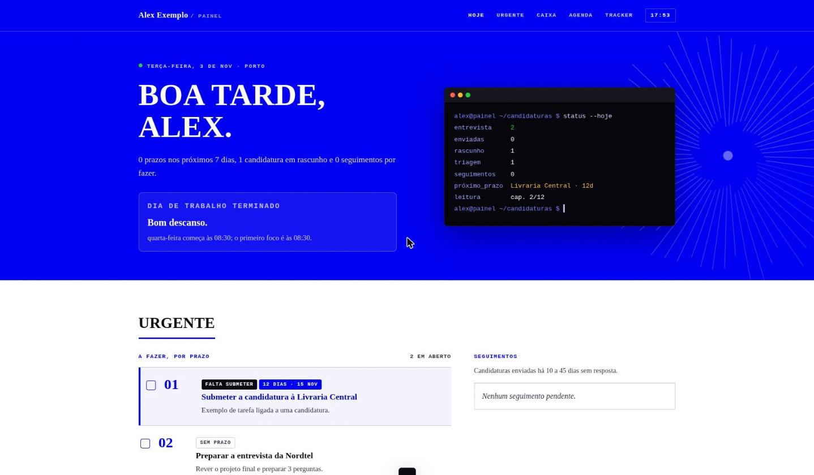

# Job Search Dashboard

A self-hosted daily dashboard for a job search. It tracks your applications on a kanban board, lists what is urgent, shows your daily routine and upcoming events, and can read your Gmail and Google Calendar to sort recruitment emails into replies, rejections, interviews and tests.

It runs in Docker in one command. It has no database and no cloud service: two JSON files on your disk are the whole state. The interface is in Portuguese (pt-PT).



## Quick start

```sh
git clone https://github.com/Joseane772/job-search-dashboard.git
cd job-search-dashboard
docker compose up -d
```

Then open <http://localhost:8787>.

On the first run, the `dados/` folder is filled with example data: a fictional person with five fictional applications. Edit `dados/tracker.json` and `dados/dia.json` to make it yours. Changes show up within 30 seconds, no restart needed.

To run it without cloning, use the published image:

```sh
mkdir -p dados
docker run -d --name painel -p 127.0.0.1:8787:8787 \
  -v "$PWD/dados:/dados" --user "$(id -u):$(id -g)" \
  ghcr.io/joseane772/job-search-dashboard:latest
```

To run it without Docker, you need Python 3.10 or newer and nothing else:

```sh
python3 painel/servidor.py --abrir
```

## What it does

- **Hoje:** a greeting, the current block of your routine, and a terminal-style summary of your search.
- **Urgente:** tasks and application deadlines in date order, plus the applications that have gone 10 to 45 days without an answer and need a follow-up.
- **Caixa:** recruitment emails from Gmail. Each email is:
  - classified by rules as a rejection, interview, test, acknowledgement, job alert or other;
  - matched to an application by company name or email domain;
  - shown with a one-click suggestion such as "move ACME to Interview".

  Nothing in the tracker changes until you click. Setup is described in [docs/google.md](docs/google.md).
- **Agenda:** today's routine on a timeline, an optional reading tracker, and upcoming events from `dia.json` and Google Calendar.
- **Tracker:** a kanban board with the stages Triagem, Rascunho, Enviada, Entrevista and Fechada. Drag a card to another column to change its stage. You can search, and filter by deadline or by your city.

## Your data

All of it lives in `dados/`, which git ignores.

| File | What it holds |
|---|---|
| `tracker.json` | One entry per application: `id`, `empresa`, `funcao`, `estado`, `enviada`, `contacto`, `local`, `prazo`, `nota`, and optionally `dominios`, the email domains that belong to the application. |
| `dia.json` | Your profile (name, city, terminal prompt), routine, one-off exceptions, events, tasks and the optional book. |
| `caixa.json` | Emails and calendar events read from Google. Created only after you connect an account. |
| `google_token.json` | The Google refresh token, mode 600. Created only after you connect an account. |

The example files in [`exemplo/`](exemplo/) document every field.

If your tracker already lives somewhere else, for example in a notes repository, point the dashboard at it:

```sh
PAINEL_TRACKER=/path/to/tracker.json PAINEL_DIA=/path/to/dia.json python3 painel/servidor.py
```

## Configuration

| Variable | Default | Meaning |
|---|---|---|
| `PAINEL_DADOS` | `./dados` (`/dados` in the container) | Data folder |
| `PAINEL_TRACKER`, `PAINEL_DIA` | inside the data folder | Paths to the two JSON files |
| `PAINEL_HOST`, `PAINEL_PORTA` | `127.0.0.1`, `8787` | Where to listen |
| `PAINEL_SYNC_MIN` | `30` | Minutes between Gmail and Calendar reads; `0` turns automatic reads off |
| `GOOGLE_CLIENT_ID`, `GOOGLE_CLIENT_SECRET` | none | Your OAuth client, or `dados/google_client.json` |
| `TZ` | `Europe/Lisbon` in Compose | Timezone |

## Security

- The API has no password. It refuses any request whose `Host` or `Origin` is not `localhost`, which blocks other web pages and DNS rebinding.
- Docker Compose publishes the port on `127.0.0.1` only. **Do not expose the port to a network.**
- Google access is read-only. Revoke it from the dashboard or at <https://myaccount.google.com/permissions>.
- The container runs as an unprivileged user, and the image contains only the Python standard library.

## Development

```sh
python3 -m unittest discover -s tests -v     # email classification tests
python3 painel/servidor.py --porta 8790      # local server with ./dados
```

The email rules live in [`painel/classificar.py`](painel/classificar.py): Portuguese and English phrases for each email type. Pull requests that add phrases from real recruiter emails are welcome.

CI runs the tests, builds the image, starts it and checks the API. On `main`, it then publishes `linux/amd64` and `linux/arm64` images to `ghcr.io/joseane772/job-search-dashboard`.

## Licence

MIT
